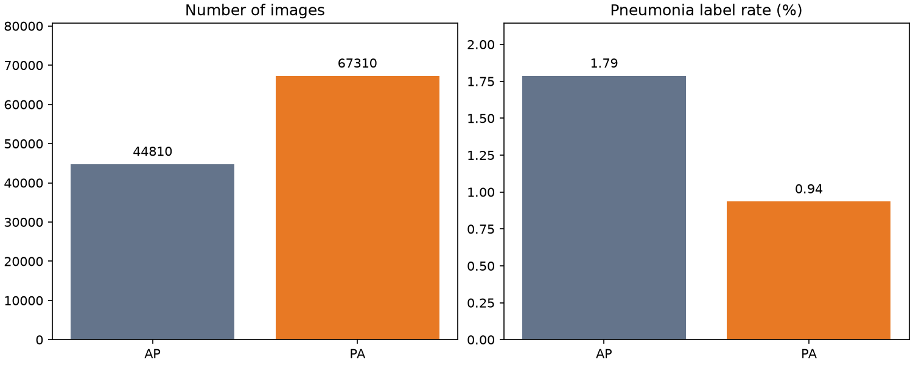

# Chest X-ray Pneumonia Label Classification

A reproducible ChestX-ray14 project covering dataset inspection, patient-disjoint sampling, preprocessing experiments, and planned model evaluation.

**Current status:** data preparation and initial exploratory analysis are complete for the selected cohort. A DenseNet-121 model definition and CPU timing check are available. Full model training, validation-based model selection, and final test evaluation have not started.

## Data and prediction target

Data provider: **NIH Clinical Center**. Metadata contains 112,120 images from 30,805 patients, including 1,431 images (1.276%) with a `Pneumonia` label.

- [Original NIH distribution](https://nihcc.app.box.com/v/ChestXray-NIHCC)
- [Kaggle distribution used by this project](https://www.kaggle.com/datasets/nih-chest-xrays/data)
- Wang et al. (2017), *ChestX-ray8: Hospital-scale Chest X-ray Database and Benchmarks on Weakly-Supervised Classification and Localization of Common Thorax Diseases*, CVPR. [Paper](https://arxiv.org/abs/1705.02315)

The binary target is **presence or absence of the `Pneumonia` metadata label**. A negative label does not establish normality or exclude pneumonia clinically. Labels originate from radiology-report processing; this project does not independently validate their clinical correctness.

## Data preparation and quality checks

Patients were assigned to a custom approximately 70/15/15 train/validation/test split, stratified by whether a patient has any Pneumonia-labeled image (seed 42). This is **not the NIH official split**.

For CPU feasibility, the training cohort retains all 1,019 positive images and randomly selects 3,057 negative images (1:3). The original full validation and test cohorts are retained, subject to exact-pixel deduplication. Training prevalence is therefore deliberately changed; model scores must not be interpreted as calibrated population disease risks.

All 37,679 selected original PNGs passed CRC and full image-decode checks. Images are 1024 x 1024; 37,514 are grayscale L and 165 are RGBA. Their total size is 15.13 GB.

File-byte hashes found no duplicates. **Decoded-pixel hashes identified six duplicate pairs, including one validation/test pair with different patient IDs.** A fixed pre-training rule retained test before validation before train, then filename order. Six entries were excluded from modeling manifests; raw files and exclusion records were preserved.

| Active cohort | Patients | Images | Pneumonia-label images | Duplicate entries excluded |
|---|---:|---:|---:|---:|
| Train | 2,858 | 4,076 | 1,019 | 0 |
| Validation | 4,621 | 16,872 | 218 | 3 |
| Test | 4,621 | 16,725 | 194 | 3 |
| Total | 12,100 | 37,673 | 1,431 | 6 |

Active manifests: `data/processed/reduced_train_full_eval_qc/{train,val,test}.csv`.
Pairwise patient overlaps and remaining exact-pixel duplicates are zero. Near-duplicate detection and comprehensive visual/clinical review remain incomplete.

## Exploratory analysis

[01_EDA.ipynb](notebooks/01_EDA.ipynb) contains executed metadata analysis, class distributions, repeated-patient structure, PA/AP comparison, and split checks.

- An always-negative rule achieves 98.72% accuracy while detecting no positive images.
- Patient image counts range up to 184; 13,302 patients have multiple images.
- AP and PA positive-label rates are 1.788% and 0.936%. This is an observational association, not evidence of causality or model reliance on view position.
- A separate image-level 80/20 split demonstrates overlap of 8,028 patients. This temporary comparison split is not used for model training or evaluation.



## Preprocessing and experiment plan

The first baseline uses **RGB conversion, 224 x 224 bilinear resizing, tensor conversion, and ImageNet normalization**. CLAHE and random augmentation are disabled for the baseline. Original image files are not overwritten.

[02_Preprocessing.ipynb](notebooks/02_Preprocessing.ipynb) records train-only visual comparisons, actual DataLoader inputs, normalized batch statistics, and deterministic evaluation checks. Optional implementations are available for:

- CLAHE: clip limit 2.0, tile grid 8 x 8, applied before resizing.
- Weak augmentation: rotation within +/-5 degrees (probability 0.5), brightness/contrast factors within 0.9-1.1 (joint application probability 0.5). No flips or random crops are configured. Rotation can introduce black borders and remove small edge regions.

| Planned experiment | Augmentation | CLAHE | Status |
|---|---|---|---|
| B0: baseline | Off | Off | Not trained |
| A1: augmentation comparison | On, train only | Off | Not trained |
| C1: CLAHE comparison | Off | On, all cohorts | Not trained |

Keep cohort assignments and other training conditions consistent across comparisons. Use validation results for method/checkpoint/threshold selection, then reserve test predictions for final evaluation after choices are fixed. Do not select methods by test performance. No improvement from CLAHE or augmentation has been established.

## Model preparation and CPU timing

Prepared model: torchvision DenseNet-121 with ImageNet-1K pretrained weights, frozen feature extractor and BatchNorm statistics, and a new single-logit classifier. The prepared loss is `BCEWithLogitsLoss`; the timing check used Adam and updated only the 1,025 classifier parameters.

A train-only 32-image timing check (batch 8, four CPU threads) gives rough estimates of 6.7 minutes per training pass, 19.5 minutes for full validation inference, and 19.3 minutes for full test inference. These are extrapolations, not measured full-run durations or accuracy results. The transient timing model was discarded. [Timing details](docs/baseline_cpu_benchmark.md).

Full training/evaluation entry points are not implemented yet; `src/train.py` and `src/evaluate.py` remain placeholders. ViT implementation, model comparisons, and Grad-CAM/error analysis are future work.

## Reproduction

The recorded environment is Windows, Python 3.13.7, PyTorch 2.15.0+cpu and torchvision 0.29.2+cpu. The CPU is an Intel i5-1340P with approximately 16 GB RAM. `requirements.txt` records the current Windows environment, including OpenCV. Fresh installation on another environment has not been verified.

Run commands from the repository root. For a new Windows environment:

```powershell
python -m venv .venv
.\.venv\Scripts\python.exe -m pip install torch==2.15.0+cpu torchvision==0.29.2+cpu --index-url https://download.pytorch.org/whl/cpu
.\.venv\Scripts\python.exe -m pip install -r requirements.txt
```

Raw data, generated manifests, model weights and the virtual environment are excluded from Git. Obtain `Data_Entry_2017.csv` from the linked distribution and place it under `data/raw/`. Cohort construction and image acquisition for a new data directory follow this order:

```powershell
.\.venv\Scripts\python.exe scripts\inspect_dataset.py
.\.venv\Scripts\python.exe scripts\summarize_metadata.py
.\.venv\Scripts\python.exe scripts\make_patient_splits.py
.\.venv\Scripts\python.exe scripts\prepare_active_dataset.py
.\.venv\Scripts\python.exe scripts\download_selected_images.py
.\.venv\Scripts\python.exe scripts\finalize_image_qc.py
.\.venv\Scripts\python.exe scripts\deduplicate_manifests.py
```

The downloader resumes verified files and retrieves selected ZIP byte ranges without saving the full archive. Remote availability and release changes can affect reproduction. Source CSV and parent-manifest SHA-256 values are recorded in reports. Existing split directories are protected against silent replacement; do not delete or regenerate evaluation cohorts to try different model results. `prepare_active_dataset.py` verifies matching existing manifests before reuse.

For an already prepared data directory, open the two notebooks with the project `.venv` kernel, or reproduce the visual checks:

```powershell
.\.venv\Scripts\python.exe scripts\preview_preprocessing.py
.\.venv\Scripts\python.exe scripts\compare_preprocessing.py
.\.venv\Scripts\python.exe scripts\preview_augmentation.py
```

Detailed tables and checks are in `outputs/metrics/`; figures are in `outputs/figures/`. Metadata summarization writes its generated report under `outputs/metrics/dataset_qc/`, preserving the cumulative QC document.

## Repository structure

```text
notebooks/       Executed EDA and preprocessing/augmentation review
scripts/         Metadata inspection, cohort preparation, downloads and QC
src/             Dataset, transforms and model definition; training/evaluation placeholders
outputs/figures/  Visual results
outputs/metrics/  Summary tables, integrity checks and exclusion records
outputs/models/  Local cached weights and future checkpoints (ignored)
docs/            Methods, limitations, timing and project-progress records
data/            Locally acquired originals and generated manifests (ignored)
```

Historical CPU-pilot manifests and scripts are retained for provenance; their reduced validation/test cohorts are not the active evaluation plan. The active paths are specified above and in `outputs/metrics/dataset_qc/active_dataset_plan.json`.

## Progress and limitations

- Completed: environment setup, dataset selection, EDA, selected-file integrity checks, exact-pixel deduplication, active patient-disjoint manifests, preprocessing/augmentation implementation and sample review.
- Prepared: first model definition and train-only CPU timing.
- Pending: first complete training run, validation-based experiment comparison, final test metrics, patient-level uncertainty estimates, subgroup/error analysis and interpretability.
- Not established: clinical label correctness, external validity, near-duplicate absence, preprocessing benefit or model performance.

Planned evaluation includes AUROC, AUPRC and threshold-based sensitivity/specificity, with uncertainty assessed at patient level. Internal split performance alone will not establish clinical applicability.

This project is intended for research and portfolio development. No model has been validated for clinical use.
