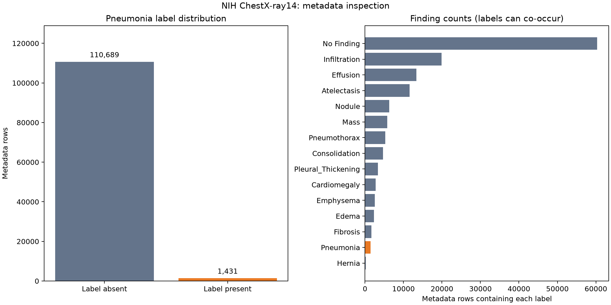

# NIH ChestX-ray14: dataset selection and initial metadata QC

Date: 2026-10-29

## Decision
Use NIH ChestX-ray14 to stay aligned with the course and inspect patient-level leakage. This is a portfolio research task predicting the presence of the Pneumonia metadata label. Source labels are report-derived and are not confirmed clinical diagnoses.

Sources: https://www.kaggle.com/datasets/nih-chest-xrays/data ; https://nihcc.app.box.com/v/ChestXray-NIHCC ; https://arxiv.org/abs/1705.02315
Before image acquisition, record the selected release and its applicable usage terms. Do not commit raw data or redistribute images.

## Observed results
- Metadata rows: 112,120; patients: 30,805.
- Pneumonia label present: 1,431 (1.2763%).
- Pneumonia label absent: 110,689. This group includes other findings and is not a normal-only group.
- Patients with at least one Pneumonia-labeled image: 1,008.
- Patients with multiple images: 13,302.
- Median / maximum images per patient: 1.0 / 184.
- Pneumonia alone / with other findings: 322 / 1109.
- Basic missingness, duplicate-row and filename-conflict results: see metadata_summary.json.



## Interpretation and next steps
1. Label imbalance makes accuracy insufficient; include AUPRC, sensitivity, specificity and AUROC. Choose thresholds using validation data only.
2. Split by Patient ID before any class balancing or image sampling. Verify disjoint patient IDs and ensure both classes occur in every split. No split has been created yet.
3. Freeze the held-out evaluation cohort. Do not use test images to select preprocessing, exclusions or thresholds.
4. Plan CPU-feasible image acquisition after inspecting archive organization. A convenience subset from one archive may alter patient and label distributions; compare the acquired subset with this metadata baseline.
5. After acquisition, inspect file existence, decoding, dimensions, formats, exact duplicates and cross-split duplicates. Visual review flags should record quality concerns, not replace source labels with unverified diagnoses.

## Reproduce
Run from the repository root:

```powershell
.\.venv\Scripts\python.exe scripts\inspect_dataset.py
.\.venv\Scripts\python.exe scripts\summarize_metadata.py
```

Metadata inspection is complete for the checks implemented. Image QC, patient splitting and model training remain pending.

## Patient split preparation completed
A custom patient-level split was created with seed 42 and approximate patient ratios of 70/15/15. This is not the NIH official split, so performance must not be presented as an official-split benchmark.

| Split | Patients | Images | Pneumonia label images |
|---|---:|---:|---:|
| Train | 21,563 | 78,517 | 1,019 |
| Validation | 4,621 | 16,875 | 218 |
| Test | 4,621 | 16,728 | 194 |

Patient overlaps are zero for all pairs, all metadata rows are assigned once, and both image classes occur in each split. Stratification uses whether a patient has any Pneumonia-labeled image; image-level positive rates need not be identical.

Manifests: `data/processed/splits/{train,val,test}.csv`. Reports: `outputs/metrics/dataset_qc/split_summary.csv` and `split_checks.json`. Code: `scripts/make_patient_splits.py` (refuses to overwrite an existing split directory).

These are full-metadata cohort assignments, not a finalized CPU training subset. Image acquisition and duplicate-image checks remain pending. Any training subset should be selected inside the training cohort; validation/test selection requires a documented plan before model evaluation.

## Image acquisition pilot
Downloaded 6 convenience-sampled PNG files from the first page of the Kaggle file listing, restricted to the existing training cohort. These are workflow checks only; they are not representative, do not form a training dataset, and do not establish dataset-wide image quality.

All 6 files decoded successfully with Pillow: 1024 x 1024, grayscale mode L, total 2,489,703 bytes. Images: `data/raw/qc_pilot/`. Report: `outputs/metrics/dataset_qc/pilot_image_qc.csv`. Download/QC code: `scripts/download_qc_pilot.py`. SHA-256 values are recorded for later duplicate checks. Clinical content and label correctness were not reviewed.

Data provider: NIH Clinical Center. Original source: https://nihcc.app.box.com/v/ChestXray-NIHCC . Cite Wang et al., ChestX-ray8, CVPR 2017. Attribution guidance: https://docs.cloud.google.com/healthcare-api/docs/resources/public-datasets/nih-chest . Download mirror: https://www.kaggle.com/datasets/nih-chest-xrays/data .

Next: define a reproducible CPU-feasible subset inside the existing patient assignments, then download the selected files and run full image QC. Validation/test sampling must be specified before evaluation; report any resulting prevalence or population changes.

## CPU pilot cohort plan (prepared before model evaluation)
Seed: 42. Parent patient splits are preserved. Training uses all 1,019 positive-label images and 3,057 random negative-label images (25% positive). Validation and test each select 1,000 patients stratified on patient-level presence of a Pneumonia label, retaining all images for those patients without image-class balancing.

| Split | Patients | Images | Positive images |
|---|---:|---:|---:|
| Train | 2,858 | 4,076 | 1,019 |
| Validation | 1,000 | 3,677 | 46 |
| Test | 1,000 | 3,277 | 45 |

Total: 11,030 images. Pairwise patient overlaps are zero, images belong to the correct parent splits, filenames are unique within each split, and both classes are present. Manifests: `data/processed/cpu_pilot/`. Code: `scripts/make_cpu_pilot.py`. Reports: `cpu_pilot_summary.csv` and `cpu_pilot_plan.json` in `outputs/metrics/dataset_qc/`.

This is an initial feasibility experiment. Only 46/45 positive validation/test images imply substantial uncertainty; these are not definitive performance estimates. Training downsampling changes prevalence, so uncalibrated probabilities are not population risks. Patient stratification does not guarantee equal image-level prevalence. Do not change the cohort or seed based on model performance.

Images for these manifests have not yet been fully downloaded. The previous 6-file QC pilot is independent of this sampling and may contain files outside these manifests. Use manifests, not directory enumeration, to define model input. Before training: acquire selected files, verify existence/decode/dimensions/hash duplicates, record exclusions, then create preprocessing and the baseline.

## Active plan update: reduced training + full evaluation
This supersedes the reduced validation/test CPU pilot for subsequent experiments. Active manifests: `data/processed/reduced_train_full_eval/{train,val,test}.csv`. Train: 4,076 images / 2,858 patients / 1,019 positive images. Validation: 16,875 images / 4,621 patients / 218 positive images. Test: 16,728 images / 4,621 patients / 194 positive images. Total: 37,679 images. Pairwise patient overlaps verified as zero. Prior manifests remain as historical artifacts.

At preparation time the C drive had approximately 723.5 GiB free and RAM was approximately 15.6 GiB (Intel Core i5-1340P). Extrapolation from the six convenience-sampled PNG files suggests 15.63 GB for selected originals, but this tiny sample is not representative and actual size is unknown. Allow additional room for downloads, processed copies and checkpoints; a 40-60 GB working budget is an initial allowance, not an upper bound. Storage appears sufficient. CPU training/evaluation duration requires a timed batch benchmark; do not load the entire dataset into RAM. Full validation increases per-epoch evaluation work; reserve test inference for the finalized model.

## Image download and QC completed (2026-10-29)
All 37,679 selected PNG files were downloaded from the Kaggle NIH mirror using byte ranges of its archive; the full ZIP was not saved. Original PNG size: 15,130,253,194 bytes (15.13 GB). Every selected file passed ZIP CRC, Pillow verify, and full decode. Metadata-to-file coverage: complete, zero missing.

All images are 1024 x 1024 PNGs. Modes: 37,514 L (grayscale), 165 RGBA. Preprocessing must explicitly normalize image mode; do not assume every PNG is single-channel.

File-byte hashes found no duplicates, but decoded-pixel hashes identified six duplicate pairs (12 images), including one validation/test pair with different patient IDs. This demonstrates why patient splitting alone does not eliminate exact image leakage. Some duplicate images have different source finding labels; all duplicates here have the same binary pneumonia target (0). Source labels were not rewritten.

Applied a fixed pre-training rule: preserve test before validation before train, then retain the first filename within a group. Removed 6 duplicate entries from modeling manifests only (validation: 3; test: 3); downloaded originals were preserved. Active manifests now live in `data/processed/reduced_train_full_eval_qc/` and supersede the earlier active directory. Retained: train 4,076 (1,019 positive), validation 16,872 (218 positive), test 16,725 (194 positive); total 37,673. Patient counts remain 2,858 / 4,621 / 4,621. Pairwise patient overlap and remaining exact pixel duplication are zero.

Reproducible code: `scripts/download_selected_images.py`, `scripts/finalize_image_qc.py`, `scripts/deduplicate_manifests.py`. Reports under `outputs/metrics/dataset_qc/`: `downloaded_image_qc.csv`, `image_inventory.csv`, `image_qc_summary.json` (pre-exclusion findings), `pixel_duplicate_images.csv`, `duplicate_exclusions.csv`, `active_dataset_summary.csv`, and `active_dataset_plan.json` (post-exclusion active plan).

Limitations: near-duplicate detection, visual quality review and clinical label validation remain pending. No model has been trained or evaluated. The earlier six-file convenience pilot remains separate under `data/raw/qc_pilot/`; model input must use the active manifests and `data/raw/images/`.

## Baseline preprocessing and train-only visual QC
See `docs/preprocessing_and_visual_qc.md` for the train-only 12-image review, limitations and transformation policy. Implemented RGB conversion, 224x224 bilinear resizing without cropping, tensor conversion and ImageNet normalization, with no baseline augmentation. A real 8-image training batch and the selected L/RGBA samples passed shape and finite-value checks. Model training/evaluation remain pending.

## First model and CPU timing
Prepared ImageNet-pretrained DenseNet-121 with a frozen backbone, frozen backbone BatchNorm state and a new 1-logit classifier. A train-only 32-image timing check passed output/loss, classifier-update and frozen-backbone checks. Timing and estimates are documented in `docs/baseline_cpu_benchmark.md`. The transient timing model was discarded. Full model training and validation/test inference have not started.
